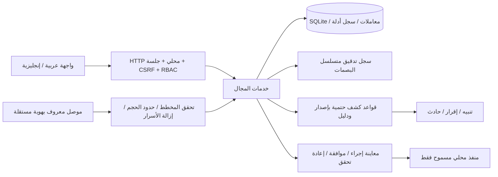

# القرار الهندسي ADR-001 — منصة الأدلة المحلية

التاريخ: 2026-11-11. الحالة: أساس هندسي؛ ليست موافقة إصدار إنتاجي.

## المشكلة والاختيار

المستودع الأصلي مواصفات فقط. نحتاج منتجًا محليًا يعمل دون خدمة سحابية أو مفاتيح خارجية، ويحتفظ بالأدلة ويمنع عرض الحماية الموهومة. نبدأ بخادم Node.js 24 وSQLite المدمجة، وواجهة Web عربية/إنجليزية بلا حزم تشغيل من npm. هذه بنية جهاز واحد، وليست إثبات سعة 20,000 أصل.

| البديل | القرار وسببه |
|---|---|
| Node.js + SQLite + ملفات واجهة محلية | المختار للنسخة المحلية: معاملات، قيود فريدة، ترحيلات واختبارات دون خدمة قاعدة بيانات منفصلة |
| PostgreSQL + مخزن أحداث + طابور موزع | مرحلة توسع مستقلة بعد قياس الحمل؛ يلزم تشغيل ونسخ احتياط ومراقبة إضافية |
| Electron أو تطبيق أصلي | مؤجل؛ المتصفح المحلي يحد من عبء توزيع محرك متصفح آخر |
| JSON كقاعدة أحداث رئيسية | مرفوض: لا يوفر معاملات ومؤشرات واتساق كتابة متعدد الجداول |
| تجميع أدوات EDR هجومية/دفاعية عشوائيًا | مرفوض: التراخيص والتوافق وصلاحيات النظام تحتاج تحققًا مستقلًا |

Node متاح محليًا بإصدار 24.21.0؛ تثبيت إصدار تصحيحي أحدث يتطلب اختبارات الإصدار. `node:sqlite` في سلسلة 24 واجهة حديثة يجب إعادة التحقق من استقرارها في ترقية runtime. لا يوجد تنزيل تلقائي أو updater غير موقع.

## المكونات وحدود الثقة

الأصل سجل مركزي واحد. الهوية القوية في البداية هي namespace المصدر + external_id؛ لا يدمج أصلان لأن IP أو hostname متساويان. هذا يمنع دمج DHCP الخاطئ لكنه لا يكمل ربط المصادر المتعددة؛ يظل ذلك قيدًا معلنًا. كل ملاحظة تحمل وقت المصدر والاستلام والبصمة، ولا تستنتج OS أو شخصًا من عنوان شبكة.

المستخدم المحلي admin/analyst/viewer. كل كتابة تتحقق على الخادم. إنشاء المشرف الأول يحتاج رمز إعداد مؤقتًا محفوظًا محليًا بصلاحيات الملف، ولا توجد كلمة مرور افتراضية. كلمات المرور عبر scrypt، الجلسات رموز عشوائية تُخزن بصمتها فقط، مع انتهاء مطلق وخمول وCSRF وOrigin/Host. الواجهة لا تحفظ أسرارًا في localStorage. HTTP مسموح على loopback فقط. الوصول الشبكي محجوب في هذه المرحلة حتى اكتمال TLS/MFA/إدارة الشهادات واختبارها.

الأحداث المستوردة غير موثوقة. نص الدليل لا يصبح تعليمات تنفيذ. لا يوجد shell أو وصول إنترنت أو اتصال نموذج لغوي من مسار التحليل. يتعامل المحلل الحالي مع الأدلة وقواعد حتمية ويُسمى تقرير أدلة، ولا يُنسب إلى LLM.

## البيانات والمعاملات

ترحيلات مرقمة لا تُعدّل بعد إصدارها. SQLite WAL وforeign_keys وbusy_timeout. تُحفظ كتابة الحدث والأصل والكشف والتدقيق ضمن معاملة واحدة؛ event_id فريد ضمن المصدر لمنع التكرار. لا يُعلن وصول حدث قبل نجاح الالتزام. قوائم الخادم محدودة الصفحات؛ الاستيراد محدود الحجم والعدد. المخطط الداخلي `cg.telemetry/1` ولا يدّعي توافق OCSF الكامل؛ محول OCSF الرسمي مرحلة لاحقة.

الاحتفاظ بأصل يحتوي أسرارًا غير مقبول. نخزن نسخة منقحة وبصمتها، مع بصمة الرسالة الأصلية فقط للمقارنة؛ لا نقول إن النسخة المنقحة هي الأصل. سجل التدقيق مقاوم لكشف تعديل تسلسل ضمن الاختبار، وليس WORM ضد مدير قاعدة البيانات. يلزم تثبيت آخر بصمة خارجيًا قبل أي ادعاء بعدم القابلية للعبث.

## إجراءات الاستجابة

كتالوج typed محدود. الإجراء المحلي الأول تعديل تصنيف أهمية أصل داخل CyberGuard فقط، مع معاينة وسبب ومدة وموافقة شخص آخر وبصمة حالة وإعادة تحقق وrollback. لا منفذ احتواء/Firewall/SSH/AD/NCC فعلي. العزل والفحوص الهجومية وتغييرات الأجهزة لا تدخل هذه المرحلة. تسمية الحالة تتبع النتيجة الفعلية، ولا تكفي استجابة API ناجحة لإثبات حماية جهاز.

## فصل المنتجات

NCC لإدارة الشبكة، IT Twin للتوأم، Tickets للصيانة. لا نعيد بناء أي منها. مكونات التكامل المستقبلية تستخدم حساب قراءة منفصلًا؛ كتابة أمنية محددة عبر بوابة الموافقات فقط. النسخة هنا لها Git وDB وخادم مستقلون؛ لا تستورد بيانات NCC أو بيانات المستخدم تلقائيًا.

## المراجع التقنية

- [Node SQLite](https://nodejs.org/docs/latest-v24.x/api/sqlite.html)
- [Node crypto](https://nodejs.org/docs/latest-v24.x/api/crypto.html)
- [ترخيص Node ومكوناته](https://github.com/nodejs/node/blob/v24.21.0/LICENSE)
- [OWASP Sessions](https://cheatsheetseries.owasp.org/cheatsheets/Session_Management_Cheat_Sheet.html)

المراجع لا تعني اجتياز تدقيق أمني خارجي؛ الاختبارات الفعلية موثقة منفصلة.
